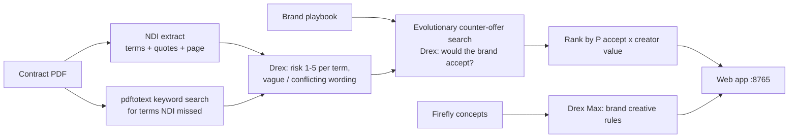

# Deal Darwin

[](https://github.com/ayushishringi/deal-darwin/actions/workflows/ci.yml)

Know what you're signing. Negotiate what you're worth.

Deal Darwin helps creators review brand sponsorship contracts:

- **Read**: NDI (Nace Document Intelligence) parses the contract, OCR included, and extracts fee, usage rights, exclusivity, payment terms, kill fee and other notable terms, each with its quote and page. If NDI misses a standard term, a keyword search over the full text is checked by Drex.
- **Rate**: Drex rates the risk of every term (1-5) and flags vague or conflicting wording.
- **Counter**: an evolutionary search proposes counter-offers. Drex judges each one ("would the brand accept this?") against the brand playbook, and offers are ranked by chance of acceptance times value to the creator.
- **Create**: Adobe Firefly campaign concepts are checked against the brand's creative rules by Drex Max (vision).

## Architecture



## Run it

```bash
cp .env.example .env          # then set NACE_API_KEY in .env
pip install -r requirements.txt
python3 deal_darwin_dataset/app/server.py
```

Open http://127.0.0.1:8765. The earlier demo page is at `/classic`.

Requires Python 3.10+ and `pdftotext` (Poppler: `brew install poppler` or `apt install poppler-utils`). The server uses only the Python standard library plus Pillow.

## Tools used

- NDI: parse and extract only
- Drex (risk, acceptance, Q&A) and Drex Max (image rule checks)
- Intern
- Adobe Firefly (image generation, done in Firefly)

## Results

Produced by `python3 deal_darwin_dataset/app/evidence.py`, which reads the cached outputs in `app/cache/` and makes no API calls. The contracts, brands and labels are synthetic, and the sets are tiny (4 contracts, 12 dev images).

**Term extraction (4 contracts × 5 terms, scored against `answer_keys/`)**

| Variant | Status correct | Risk within ±1 | Source |
|---|---|---|---|
| NDI only | 15 / 20 | — | computed from cache |
| NDI + Drex (current) | 14 / 20 | 16 / 19 | computed from cache |
| pdftotext + Drex status | 15 / 20 | 16 / 19 | console log, 2026-11-14 (cache since overwritten) |
| pdftotext + Drex + ambiguity questions | 14 / 20 | 16 / 19 | console log, 2026-11-14 (cache since overwritten) |

**Counter-offer search.** Value recovered is the true expected value of the top pick, minus that of the contract as written, under the simulated brand.

| Contract | Baseline (v1) | Evolutionary search (v2) | Best possible | v2 pick in true top 10 |
|---|---|---|---|---|
| A | −0.364 | −0.011 | 0.054 | no |
| B | 0.018 | 0.234 | 0.316 | no |
| C | 0.018 | 0.382 | 0.492 | no |
| D | −0.311 | 0.051 | 0.098 | no |

**Creative rule checks (Drex Max, 12 dev images, threshold 0.5):** correct on R1 8/12, R2 12/12, R3 12/12, R4 11/12, R5 11/12.

**Cost of the cached runs:** NDI extraction $0.094 for 4 contracts; 484 Drex calls for the 4 counter searches.

## Tests

```bash
pip install -r requirements.txt pytest ruff==0.8.4
ruff check .
python -m pytest -v tests                       # offline: metrics, brand simulator, creator utility
python deal_darwin_dataset/scripts/validate.py  # dataset sanity checks (needs pdftotext)
```

CI runs all three on every push and pull request. Regenerating the dataset (`scripts/make_*.py`) also needs `reportlab`, which is not in `requirements.txt`.

## Honest limits

- Brands, contracts and labels are synthetic; the test sets are small. This is a pilot, not a benchmark.
- Counter-offer "value recovered" is measured against a simulated brand from the dataset.
- The four Firefly concepts were generated in Firefly beforehand; the app scores them, it does not generate images.
- Drex returns probabilities, not explanations.

## Layout

- `deal_darwin_dataset/app/`: server, pipelines, cache, web app (`app/web/`)
- `deal_darwin_dataset/contracts/`, `brand/`, `creative/`, `answer_keys/`: sample contracts, playbooks, images and labels
- `deal_darwin_dataset/scripts/`: dataset generation and evaluation
